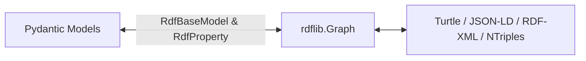

# Technical Implementation Guide: `dartfx-rdf`

## Architecture Overview

`dartfx-rdf` provides bidirectional, type-safe mapping between Pydantic v2 data models and RDF graphs backed by `rdflib`.

---

## Core Components

### 1. `RdfBaseModel` (`dartfx.rdf.pydantic._base`)
Base class inheriting from `pydantic.BaseModel`.

- **`rdf_type`**: ClassVar specifying the RDF type(s) for instances. Accepts a scalar (`str | URIRef`), sequence (`list | tuple`), or `set` of URIs (e.g. `[SCHEMA.PropertyValue, CDI.InstanceVariable]`).
- **`rdf_preserve_unmodeled_types`**: ClassVar boolean (default `True`). Preserves incoming unmodeled `rdf:type` statements from existing graphs on round-trip. Set to `False` for strict canonical exports.
- **`rdf_namespace`**: Namespace prepended to relative identifiers.
- **`rdf_id_field`**: Model field used as subject identifier (defaults to `"id"`).
- **`rdf_prefixes`**: Namespace prefix bindings for clean serialization.
- **`_extra_rdf_types`**: Private attribute (`PrivateAttr(default_factory=set)`) holding extra graph types discovered during deserialization.
- **`rdf_uri_generator`**: Strategy for minting RDF subject URIs. Defaults to `DefaultUriGenerator()`.

### 2. `RdfProperty` (`dartfx.rdf.pydantic._base`)
Metadata descriptor used inside `Annotated[T, RdfProperty(...)]`.
- `predicate`: Target predicate URI.
- `datatype`: Optional XSD datatype override.
- `language`: Optional language tag for literals.
- `serializer`: Optional custom function `(PythonValue) -> RDFNode`.
- `parser`: Optional custom function `(RDFNode) -> PythonValue`.

### 3. Multiple RDF Types & Polymorphic Dispatch
- **Serialization**: `_serialise_into_graph` emits triples for all URIs in `_extract_rdf_types(self)`. If `rdf_preserve_unmodeled_types` is `True`, it also emits all URIs in `_extra_rdf_types`.
- **Subject Inference**: `_infer_subject` computes set intersection across all types declared in `rdf_type` to locate candidate resources in multi-resource graphs.
- **Polymorphic Dispatch**: When a nested field accepts a union of models (`Union[ModelA, ModelB]`), `from_rdf_graph` calls `_resolve_model_for_node`, which scores each candidate model against the node's `rdf:type` triples in the graph to instantiate the most specific matching class.

### 4. Language Strings & Localized Literals
- **`LangString`**: Frozen model representing a literal value with an optional language tag.
- **`LangStringList`**: Subclass of `list[LangString]` with language inspection helpers (`has_language`, `get_by_language`, `languages`, `count_by_lang`) and deduplicating mutation methods.
- **`LocalizedStr`**: Annotated type alias with a BeforeValidator coercing strings, dicts, and LangString lists into canonical `LangStringList`.

### 5. URI Generators (`dartfx.rdf.pydantic._uri_generators`)
- `DefaultUriGenerator`: Standard resolution (id field → namespace/base_uri → UUID fallback).
- `TemplateUriGenerator`: URI formatting using a string template with model fields.
- `HashUriGenerator`: Deterministic cryptographic hash of model fields.
- `CompositeUriGenerator`: Priority-ordered chain of generators.
- `PrefixedUriGenerator`: Fixed prefix concatenated with a field.
